  

<!-- Liens : remplace les placeholders puis retire ce commentaire

  
  
  
  

-->

---

<table>
<tr>
<td valign="top">

### About

Building things with code and with a camera. No noise, no filler - just clean execution.

I write the code, shoot the footage and cut the edit. 3rd year **BUT MMI** student at IUT de Béziers, south of France.

### Currently

- **Clapper** - a terminal app built with Node.js and Ink to run video shoots: shot lists, gear checklists, local storage, ASCII boot screen
- **MMI Town** - Discord bot for a Minecraft server: account linking, player profiles, leaderboards, tickets and suggestions
- **VR zombie survival** - a VR game in Unity, currently in the game design phase

</td>
<!-- Photo à droite : ajoute assets/side.jpg puis décommente
<td width="35%" align="center" valign="middle">
    
</td>
-->
</tr>
</table>

---

<h3 align="center">Tech Stack</h3>

  

<h3 align="center">Tools</h3>

  
  
  
  
  
  
   
  
  
  
  
  

---

<h3 align="center">Statistics</h3>

  
  

  

